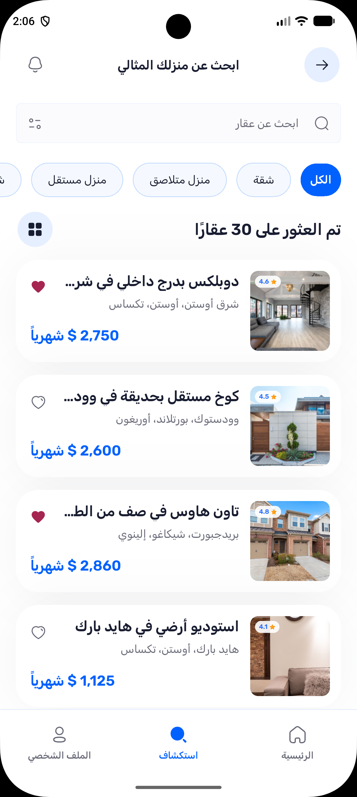
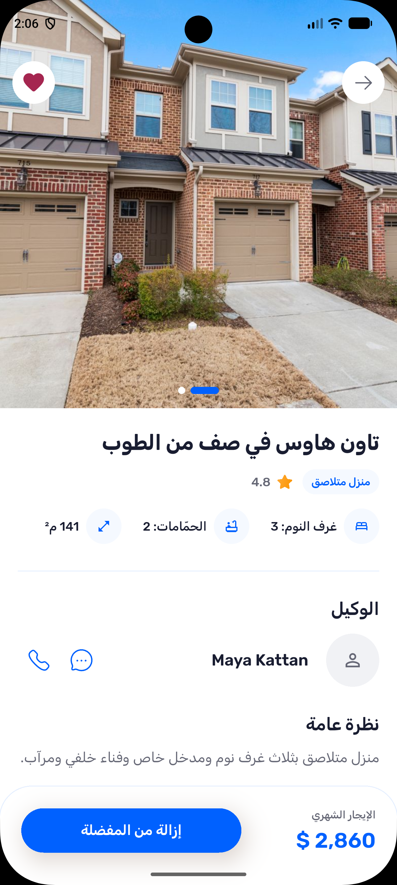

# Real Scout

Real Scout is a bilingual Flutter recruitment assessment for Android and iOS. It lets users explore fictional rental properties from a deployed REST API and save listings to a Google-backed account.

## Main features

- **Home and Explore** feature rental recommendations, searchable grid and list views, and server-side filtering and pagination. Advanced Filters uses the API’s price histogram and ranges.
- **Property Details** includes a swipeable photo gallery with zoom, property facts, facilities, reviews, a live OpenStreetMap preview and an external map action.
- **Authentication and Profile** support guest browsing, Google sign-in, session restoration, My Favorites, language and appearance settings, and logout. Favorite changes update across screens and recover if a save fails.
- **Responsive layouts** adapt to narrower phones, larger system text, and both text directions.

## Technology stack

| Technology | Role |
| --- | --- |
| Flutter 3.50.1 stable, Dart 3.14.0, `material_ui` | Mobile UI and shared design components |
| Riverpod and `riverpod_generator`, `go_router` | State, dependency injection, and persistent tab navigation |
| Dio, Freezed, `json_serializable`, `build_runner` | REST transport, immutable models, and generated JSON decoding |
| Firebase Auth and Google Sign-In | Google authentication and Firebase session management |
| Flutter `gen_l10n`, `intl`, `shared_preferences` | Translations, locale-aware formatting, and persistent preferences |
| `cached_network_image`, `flutter_svg`, `skeletonizer` | Cached media, vector assets, and loading states |
| Flutter Map, `latlong2`, `url_launcher` | Embedded maps, geographic coordinates, and external map handoff |
| `flutter_test`, Mocktail, `flutter_lints` | Automated tests, test doubles, and static analysis |

## Architecture and project structure

The app is organized by feature. Presentation reads Riverpod application state. Application logic depends on domain contracts, and data adapters implement those contracts through Dio and Firebase. The indexed navigation shell retains the Home, Explore, and Profile tabs. Details and My Favorites open as dedicated routes.

| Path | Contents |
| --- | --- |
| [lib/app](lib/app) | Root app, navigation, and tab shell |
| [lib/core](lib/core) | Network policy, configuration, errors, responsive layout, and design system |
| [lib/features](lib/features) | Properties, authentication, favorites, and profile |
| [lib/l10n](lib/l10n) | English and Arabic translations |
| [android](android) and [ios](ios) | Native runners and client configuration |
| [test](test) | Unit, provider, and widget tests |

## Setup

Use Flutter **3.50.1 stable** with Dart **3.14.0** and the checked-in [package lockfile](pubspec.lock). For Android, install SDK Platform 36 and NDK 28.2.13676358, and use a JDK compatible with Gradle 9.5.0. Use a Google Play emulator image or a device with Google Play services for Google sign-in. For iOS, use macOS with Xcode and an iOS 15 or later target. The runner uses Flutter’s Swift Package Manager integration.

From the repository root, with a mobile target running or connected:

```sh
flutter doctor -v
flutter pub get
flutter devices
flutter run
```

Generated Dart sources are checked in. After editing translations, run `flutter gen-l10n`. After changing generated providers or models, run `dart run build_runner build`.

## Production API

The default base URL is `https://real-estate-api-gray.vercel.app/api/v1`. Public property reads work in guest mode. Localized requests send `Accept-Language`, while profile and favorites use Firebase ID tokens. To target another compatible HTTPS backend, use `flutter run --dart-define=API_BASE_URL=https://example.test/api/v1`. [API contract](API_CONTRACT.md)

## Firebase authentication

The checkout includes the Flutter, Android, and iOS client configuration for the existing Firebase project. The Android application ID and iOS bundle ID are both `com.majdjabbour.realestate`. Firebase Admin credentials stay on the backend.

For a different Android signing key, run `cd android && ./gradlew :app:signingReport`, register the SHA-1 and SHA-256 fingerprints in Firebase, and refresh `google-services.json` as needed. On iOS, keep the Google OAuth client and reversed-client callback scheme aligned with the Firebase configuration. A separate Firebase project requires a backend configured to accept its tokens. [FlutterFire setup](https://firebase.google.com/docs/flutter/setup)

### Live account verification

Open Profile, sign in with Google and confirm the backend-verified identity. Cold-relaunch the app to check session restoration. Sign out, confirm private data clears, then verify public browsing and account switching.

### Live favorites verification

With an authorized test account, save a property and confirm its heart state across Details, Home and Explore. Reopen My Favorites after a cold relaunch to confirm persistence. Remove the property and verify the list and hearts update. Restore the test account’s original favorites afterward.

## Localization and themes

English and Original Blue are the fresh-install defaults. Profile lets users switch between English and Arabic and choose Original Blue, New Purple, or New Orange. Changes apply immediately and persist across launches. Arabic mirrors the layout and loads Arabic property content from the API.

## Screenshot gallery

### Main Experience

| Explore | Filters | Details |
| --- | --- | --- |
|  |  |  |

### Authentication & Profile

Google sign-in is awaiting clearance for the supplied collage. Profile needs a privacy-safe capture, and My Favorites needs a dedicated capture.

### Arabic & RTL

| Explore | Filters | Details |
| --- | --- | --- |
|  |  |  |

### Theme Variants

Home and the Blue, Purple, and Orange comparisons need guest-mode or demo-account captures.

Property photography in the gallery comes from the demo API. [Asset licenses and attribution](assets/ASSET_LICENSES.md)

## Testing and verification

```sh
dart format --output=none --set-exit-if-changed lib test
flutter analyze
flutter test
flutter test --coverage
flutter build apk --debug
```

A clean clone of revision `b547946` passed dependency resolution and analysis, **294 tests**, and the **Android debug build**. Line coverage was **90.52%** (4,238 of 4,682 instrumented lines). All 35 declared Flutter assets matched the packaged APK. Automated tests use controlled dependencies and cover API parsing, localization, layouts, filters, pagination, and session-scoped favorites. [Verification evidence](docs/ENGINEERING_AUDIT.md#phase-931-final-verification)

## Assumptions and limitations

- Listings, locations and prices are fictional. Rent is monthly in USD and area is in square meters. Photos and live map tiles depend on external services. The map displays OpenStreetMap attribution.
- Booking, payments, messaging, notifications, and other inactive Profile actions are outside the assessment scope.
- Live Google sign-in and backend profile verification were confirmed by the developer. Platform-by-platform confirmation of session restoration, logout, account switching and authenticated favorites persistence remains open.
- The supplied brand marks and sign-in collage have unresolved redistribution rights. Public distribution of the repository or builds containing those assets requires permission or licensed replacements. Captures showing account information also require a privacy-safe replacement before sharing. [Asset licenses and attribution](assets/ASSET_LICENSES.md)

## Documentation

- [Design system](DESIGN_SYSTEM.md)
- [API contract](API_CONTRACT.md)
- [Engineering verification](docs/ENGINEERING_AUDIT.md)
- [AI usage](AI_USAGE.md)
